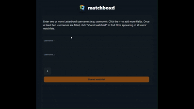

# Matchboxd!
> Generates a shared watchlist for 2 or more letterboxd users!

Demo:
https://matchboxd-5y5i.onrender.com/

*(Currently only works with users with small watchlists due to constraints with free hosting :((( )*

###### Built with Python and Flask, the app uses web scraping with Requests and BeautifulSoup to collect Letterboxd watchlist data, compares shared films across multiple users, and renders the results in the browser.

<!--  -->
